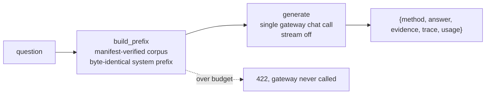

# CAG — Cache-Augmented Generation showcase

> **Status: CACHE REUSE NOT VERIFIED**
> The mechanics (builder, API, benchmark harness, evals) are implemented and
> tested, but prefix-cache reuse has NOT yet been observed on the live vLLM
> server. That proof requires the cluster session in
> `eval/reports/2026-10-27-cag-live.md`, which records prefix-cache counter
> deltas. Until then this label stays.

CAG answers questions about **one small, versioned operations handbook** by
putting the *entire corpus* in the system prompt of every request. There is
no online retrieval at all — no embeddings, no Qdrant, no reranking, nothing
to query. Because the corpus is a stable prefix and only the question
changes, vLLM's automatic prefix caching should reuse the corpus KV blocks
across requests, making warm requests skip most of the prefill work. The
benchmark harness exists to verify that claim with the server's own
counters; it is not asserted without evidence.

Contrast with the other showcases: RAG retrieves a few chunks per question
(flexible, corpus can be huge); TAG synthesizes SQL over structured data;
CAG does neither — it pays one prefill for a bounded corpus and reuses it.

## Request path



The same system message is sent for every request; the model server's
prefix cache is the only acceleration mechanism. `/warmup` sends one fixed
probe to prime that cache explicitly.

## Corpus provenance and budget

Six extracts under `corpus/`, copied **verbatim** (section level) from the
repository's own docs; each starts with a `<!-- source: ... -->` header.
The corpus is pinned by `corpus/manifest.json` (per-file sha256, overall
corpus sha256, real-tokenizer counts). `corpus.py` refuses to serve bytes
that no longer match the manifest — edit an extract, then regenerate with
`.venv-showcases/bin/python showcases/cag/build_manifest.py`.

Current manifest (`corpus_sha256_short: c2d8c188e9e6`, tokenizer
`Qwen/Qwen2.5-Coder-14B-Instruct-AWQ` from the HF hub):

| file | tokens | bytes | source |
| --- | ---: | ---: | --- |
| routing-architecture.md | 1637 | 5941 | docs/semantic-routing-walkthrough.md |
| gateway-integration.md | 598 | 2509 | docs/semantic-routing-walkthrough.md |
| operator-guide.md | 1261 | 4473 | docs/implementation-guide.md |
| cost-model.md | 591 | 2062 | docs/cost-checkpoint.md |
| routing-behavior.md | 708 | 3028 | docs/experimenting-with-routing.md |
| rag-design.md | 2833 | 11016 | docs/rag-architecture.md |
| **total** | **7628** | | budget 12000 |

Budget rule enforced before every model call (`corpus.build_messages`):
`corpus_tokens (manifest) + question_tokens + 512 (chat template reserve) +
max_output_tokens (default 1024) <= 32768 (maxModelLen)`, and the corpus
itself must stay ≤ 12000 tokens. Violations raise `BudgetExceeded` and the
gateway is never called (HTTP 422). The token counter uses the real HF
tokenizer when importable, falling back to a clearly-flagged `chars//2`
estimate.

## Prompt contract (why caching can work at all)

- The system content is **byte-identical across requests**: no timestamps,
  no request IDs, no nonces, no per-user memory.
- The question is always the **suffix** (user message); documents appear in
  manifest order, never filesystem order.
- The corpus version is the manifest sha256 (short form), exposed in every
  response's `evidence.corpus_version` and as a `cag_corpus_version` label
  on the prefix-size metric.

Breaking any of these rules would change the prefix and silently defeat
prefix caching; the tests lock them down (byte-identity across questions,
ordering, no ID/timestamp patterns, sha mismatch fails loud).

## Quickstart (local, no GPU, no network)

```bash
python3 -m venv .venv-showcases
.venv-showcases/bin/pip install -r showcases/cag/requirements.txt -r showcases/requirements-dev.txt

CAG_FAKE_MODEL=1 .venv-showcases/bin/uvicorn app:app --port 8092 --app-dir showcases/cag &

curl -s http://localhost:8092/healthz
curl -s -X POST http://localhost:8092/chat \
  -H 'Content-Type: application/json' \
  -d '{"question": "What is the idle monthly cost of the stack?"}'
curl -s -X POST http://localhost:8092/warmup
curl -s http://localhost:8092/metrics | grep ag_demo_cag
```

`CAG_FAKE_MODEL=1` swaps the gateway transport for a scripted extractive
model (`fake_model.py`) that quotes the best-matching corpus unit with a
source citation and reports synthetic-but-consistent usage. Without it the
app needs the real gateway (`GATEWAY_URL=http://localhost:8081/v1` after
the Envoy port-forward, `GATEWAY_API_KEY`, `GATEWAY_MODEL`); see
`eval/reports/2026-10-27-cag-live.md`.

Env config: `GATEWAY_URL`, `GATEWAY_API_KEY`, `GATEWAY_MODEL` (default
`Qwen/Qwen2.5-Coder-14B-Instruct-AWQ`), `CAG_MAX_OUTPUT_TOKENS` (default
1024), `CAG_CORPUS_DIR`, `CAG_FAKE_MODEL`.

Endpoints: `POST /chat {question}`, `POST /warmup`, `GET /healthz`
(re-verifies the manifest), `GET /metrics` (`ag_demo_cag_stage.duration`,
`ag_demo_cag_prefix.tokens`, `ag_demo_cag_requests`, plus GenAI conventions
`gen_ai.client.operation.duration` / `gen_ai.client.token.usage`).

## Testing

```bash
.venv-showcases/bin/python -m pytest showcases/cag/tests -q
```

Pure local: tmp-path fixture corpora with their own manifests, injected
stub token counters, fake transports; no network. Covers prefix stability,
manifest staleness, budget failures (build-time and request-time, gateway
never called), a static import check proving no retrieval stack is
imported, the benchmark parser/phases/verdict logic, and the HTTP contract.

Run each showcase suite in its own pytest process
(`pytest showcases/cag/tests`, `pytest showcases/tag/tests`): both demos
ship a flat `app.py`/`fake_model.py` layout for `uvicorn --app-dir`, and
same-named modules cannot coexist in one pytest process. This matches the
testing policy in `showcases/README.md`.

## Benchmark (live session)

`benchmark.py` measures cache reuse honestly — from the model server's own
Prometheus counters, never from latency:

```bash
.venv-showcases/bin/python showcases/cag/benchmark.py \
  --app-url http://localhost:8092 \
  --vllm-metrics-url http://localhost:8000/metrics \
  --questions eval/showcases/cag_questions.yaml \
  --n-warm 10 --report report.json
```

Phases: (a) poll `/healthz` until ready (pod readiness recorded
separately), (b) scrape counters, then one **cold-prefix prime** measured
alone — this is cache-priming prefill, not pod startup, (c) warm loop of
`n_warm` streaming requests with rotating distinct questions (TTFT +
end-to-end latency each), (d) re-scrape counters and compute deltas,
(e) verdict: `VERIFIED` only if the hits counter (`vllm:prefix_cache_hits`
by default, overridable with `--counters` after confirming names on the
deployed version) actually increased; otherwise `NOT VERIFIED`. All raw
samples are kept in the report. `--restart-test` (requires
`AG_ALLOW_POD_RESTART=1`) deletes the vLLM pod to demonstrate the cache is
process-local and must be re-primed.

Quality eval (no latency claims):

```bash
.venv-showcases/bin/python eval/run_cag_eval.py [--url http://localhost:8092] \
  [--questions eval/showcases/cag_questions.yaml] [--report ...] [--note ...]
```

Scores required mentions + source citations for corpus questions and the
not-covered fallback for out-of-corpus ones; exits non-zero if any corpus
question fails. The 2026-10-27 fake-model run passed 15/15 and is a harness
baseline, not a model-quality measurement.

## Kubernetes deployment

The image contains the app modules plus the pinned corpus (`corpus/`
including `manifest.json`). The tokenizer package is dev-only; in the image
the budget check uses the flagged `chars//2` estimate and the 512-token
template reserve (the corpus numbers themselves come from the manifest, so
they stay exact).

```bash
docker build -t us-central1-docker.pkg.dev/YOUR_PROJECT_ID/showcases/ag-cag:v0.1.0 showcases/cag
docker push us-central1-docker.pkg.dev/YOUR_PROJECT_ID/showcases/ag-cag:v0.1.0

showcases/demo.sh up cag
showcases/demo.sh port-forward cag    # http://localhost:8092
curl -s -X POST localhost:8092/chat -H 'Content-Type: application/json' \
  -d '{"question": "What is the idle monthly cost of the stack?"}'
curl -s -X POST localhost:8092/warmup
```

Evidence: `evidence.corpus_version` and `trace.cache_verified` (stays
`false` until the live benchmark records counter deltas);
`ag_demo_cag_prefix.tokens` is labeled by corpus version on `/metrics`.
Benchmark from the live session doc: `eval/reports/2026-10-27-cag-live.md`.
The manifest's `GATEWAY_URL` carries the `/v1` suffix; the Envoy service
name hash is copied from the retrieval manifest — verify with
`kubectl get svc -n envoy-gateway-system`. Memory limit is 768Mi (the
corpus is loaded in process memory).

Cleanup: `showcases/demo.sh down cag`.

## Limitations

- **Prefix caching reduces prefill work only.** It does not speed up decode
  (token generation), and it does nothing for pod startup or
  scale-from-zero provisioning (a cold GPU wake stays minutes-long; that is
  the readiness phase, not the cache).
- **Reuse is block- and prefix-dependent.** Any change to the prefix —
  corpus edit, reordered files, injected timestamps — evicts reuse from
  that point on. Cache capacity is finite; under memory pressure vLLM can
  evict blocks, so reuse is best-effort, not guaranteed.
- **The cache is process-local.** It dies with the pod: restart,
  reschedule, or scale-to-zero wipes it and the next request pays full
  prefill again. On a scale-to-zero stack the cache only pays off when the
  GPU stays awake across many corpus questions.
- **CAG fits small, stable corpora.** For large or frequently-changing
  corpora the fixed prefill cost and prefix invalidation make CAG worse
  than retrieval; it does not automatically beat RAG on quality or latency,
  and this repo runs it only against a bounded, versioned handbook.
- **Persistent/distributed KV offload is out of scope** (no LMCache, no
  shared cache tier); this demo uses only stock vLLM automatic prefix
  caching.
- The fake model is a scripted extractive quoter for offline demos/tests;
  it proves the request path, not LLM answer quality.

## Cleanup

```bash
kill %1                 # stop uvicorn (or: pkill -f "uvicorn app:app")
rm -rf .venv-showcases  # local venv (also removes the tokenizer cache)
```

The corpus and manifest are source files — keep them. Nothing outside the
working directory is touched: no cluster resources, no Terraform state.
