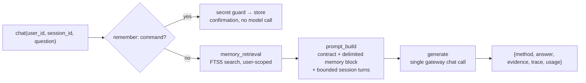

# MAG — Memory-Augmented Generation showcase

MAG is a cross-session operations assistant with **transparent, explicit,
user-scoped memory**. Users store facts deliberately (`remember: ...` or
`POST /memories`), and every later chat retrieves relevant memories by
keyword search and injects them into the prompt. Where RAG retrieves from
a shared document corpus, MAG retrieves from a per-user store that the
user can inspect, correct, and wipe at any time.

Honesty boundary: this is **application-level** Memory-Augmented
Generation. It is not MemOS, not Mem0, not a trainable memory
architecture, and not a change to model parameters. The `user_id` field is
a scoping label for the demo, **not authentication** — the service stays
private (ClusterIP-only, same Bearer-key gateway as the rest of the
stack); production identity is out of scope.

## Memory model

Two kinds of state, both strictly per-user (SQLite, FTS5 full-text search
with bm25 ranking — probed available on this toolchain; a LIKE fallback
covers builds without FTS5):

| kind | scope | lifetime | writes |
| --- | --- | --- | --- |
| long-term memories | per user, crosses sessions | until corrected or deleted | explicit only: `remember:` command or API |
| session turns | per user + session | rolling window (last 8 injected, pruned past 50) | automatic per chat turn |

- **Explicit writes only.** There is no automatic LLM extraction of "what
  to remember" — that is a deliberate deferred feature, so every memory is
  user-authored and auditable.
- **Correction supersedes, never mutates**: the old row becomes
  `superseded` and points at the new one (`superseded_by`); only the new
  text is ever retrieved.
- **Deletion is soft** (`status='deleted'`) so the audit trail survives;
  deleted and superseded rows are excluded from search, prompts, and
  listings.
- **Cross-user access is indistinguishable from nonexistence**: every
  lookup is user-filtered and returns the same 404.

## Request path



## Boundaries enforced in the prompt path

- **Secret guard**: memory writes are rejected (API 422) or refused with a
  warning (`remember:` chat) when the text matches conservative
  secret-shaped patterns: Bearer tokens, `sk-…`/`ghp_…`/`github_pat_…`/
  `xox…` API keys, AWS `AKIA…`, `-----BEGIN … PRIVATE KEY-----`, GCP
  service-account `"private_key":`, `password`/`passwd` assignments, and
  `Authorization:` header lines. The list is intentionally conservative —
  it is a seatbelt, not a DLP system.
- **Prompt boundary**: memories are untrusted data. The system contract
  states they are not instructions, may be stale or wrong, and can never
  override the contract; memory text is sanitized (control characters
  stripped, delimiter-spoofing tags neutralized) before injection, and the
  tests verify injection-style memories stay inside their block.

## Demo script (Alice/Bob, fake model, no GPU/network)

```bash
python3 -m venv .venv-showcases
.venv-showcases/bin/pip install -r showcases/mag/requirements.txt -r showcases/requirements-dev.txt
MAG_FAKE_MODEL=1 .venv-showcases/bin/uvicorn app:app --port 8093 --app-dir showcases/mag &

# Alice stores a preference in session A (explicit write, no model call)
curl -s -X POST localhost:8093/chat -H 'Content-Type: application/json' \
  -d '{"user_id":"alice","session_id":"demo-A","question":"remember: I prefer concise answers"}'
# → "Stored as memory #1: I prefer concise answers"

# Alice asks from a NEW session B: long-term memory crosses sessions, turns do not
curl -s -X POST localhost:8093/chat -H 'Content-Type: application/json' \
  -d '{"user_id":"alice","session_id":"demo-B","question":"How should you answer me?"}'
# → "Based on your stored memory [1] \"I prefer concise answers\", ..."
#   evidence.session_turns_used == 0, evidence.memory_ids == [1]

# Bob, same question: sees nothing
curl -s -X POST localhost:8093/chat -H 'Content-Type: application/json' \
  -d '{"user_id":"bob","session_id":"demo-B","question":"How should you answer me?"}'
# → generic answer, evidence.memory_ids == []
curl -s "localhost:8093/memories?user_id=bob"        # → count 0

# Bob cannot correct or delete Alice's memory
curl -s -X POST localhost:8093/memories/1/correct -H 'Content-Type: application/json' \
  -d '{"user_id":"bob","text":"hijacked"}'           # → 404
curl -s -X DELETE "localhost:8093/memories/1?user_id=bob"   # → 404

# Alice corrects her memory: old text superseded, new text recalled
curl -s -X POST localhost:8093/memories/1/correct -H 'Content-Type: application/json' \
  -d '{"user_id":"alice","text":"I prefer detailed answers with examples"}'
# → {"id":2,"superseded":1}
curl -s -X POST localhost:8093/chat -H 'Content-Type: application/json' \
  -d '{"user_id":"alice","session_id":"demo-C","question":"How should you answer me?"}'
# → references memory [2] "I prefer detailed answers with examples"

# Secret-like writes are refused
curl -s -X POST localhost:8093/memories -H 'Content-Type: application/json' \
  -d '{"user_id":"alice","text":"password = hunter2"}'    # → 422
curl -s -X POST localhost:8093/chat -H 'Content-Type: application/json' \
  -d '{"user_id":"alice","session_id":"demo-A","question":"remember: api key sk-abcdefghijklmnop"}'
# → "Not stored: API key-like content must not be stored as a memory. ..."

# Alice deletes her memory; it disappears from prompts and listings
curl -s -X DELETE "localhost:8093/memories/2?user_id=alice"
curl -s "localhost:8093/memories?user_id=alice"      # → count 0

# Observe state and metrics
curl -s localhost:8093/healthz
curl -s localhost:8093/metrics | grep ag_demo_mag
```

Live mode needs the real gateway (`GATEWAY_URL=http://localhost:8081/v1`
after the Envoy port-forward, `GATEWAY_API_KEY`, `GATEWAY_MODEL`); see
`eval/reports/2026-10-27-mag-live.md`.

## API reference

| endpoint | body / params | result |
| --- | --- | --- |
| `POST /chat` | `{user_id, session_id, question}` | pipeline result (`method`, `answer`, `evidence`, `trace`, `usage`); `remember: <fact>` stores instead of chatting |
| `POST /memories` | `{user_id, text, category?}` | `{id}`; 422 with reason if secret-like |
| `GET /memories` | `?user_id=…` | active memories for that user only |
| `POST /memories/{id}/correct` | `{user_id, text}` | `{id: new_id, superseded: id}`; 404 unknown/cross-user |
| `DELETE /memories/{id}` | `?user_id=…` | `{deleted: id}`; 404 unknown/cross-user |
| `DELETE /memories` | `?user_id=…` | `{deleted: n}` |
| `GET /healthz` | — | db writability check + active memory count |
| `GET /metrics` | — | `ag_demo_mag_*` + `gen_ai.client.*` |

Env config: `GATEWAY_URL`, `GATEWAY_API_KEY`, `GATEWAY_MODEL` (default
`Qwen/Qwen2.5-Coder-14B-Instruct-AWQ`), `MAG_DB_PATH` (default
`showcases/mag/data/mag.db`), `MAG_SESSION_TURN_LIMIT` (default 8),
`MAG_FAKE_MODEL`.

## Evaluation

```bash
.venv-showcases/bin/python eval/run_mag_eval.py [--url http://localhost:8093] \
  [--scenarios eval/showcases/mag_scenarios.yaml] [--report ...] [--note ...]
```

Five deterministic scenarios: cross-session recall, user isolation,
correction flow, forgetting flow, secret rejection. Any failed expectation
exits non-zero. Run against a fresh database (the scenarios assert exact
counts). The 2026-10-27 fake-model run passed 5/5 and is a harness
baseline, not a model-quality measurement.

## Testing

```bash
.venv-showcases/bin/python -m pytest showcases/mag/tests -q
```

Pure local: tmp-path databases, fake transport, no network. Covers the
store (CRUD, isolation, supersede/delete semantics, persistence across
reopen, FTS ranking, syntax-garbage queries, turn pruning, stats), the
pipeline (secret patterns, sanitization, prompt contract and injection
containment, remember/recall/correct/delete flows), and the HTTP API
(full Alice/Bob flow, 422s, 404s, metrics). Run suites per showcase
(`pytest showcases/mag/tests`, `…/tag/tests`, `…/cag/tests`) — the flat
`app.py` module names cannot coexist in one pytest process.

## Kubernetes deployment

The image contains the app modules only; memories live on a dedicated PVC
(`k8s/showcases/mag/pvc.yaml`, 1Gi `standard-rwo`, mounted at `/data` with
`MAG_DB_PATH=/data/mag.db`):

```bash
docker build -t us-central1-docker.pkg.dev/YOUR_PROJECT_ID/showcases/ag-mag:v0.1.0 showcases/mag
docker push us-central1-docker.pkg.dev/YOUR_PROJECT_ID/showcases/ag-mag:v0.1.0

showcases/demo.sh up mag
showcases/demo.sh port-forward mag    # http://localhost:8093
curl -s -X POST localhost:8093/chat -H 'Content-Type: application/json' \
  -d '{"user_id":"alice","session_id":"demo-A","question":"remember: I prefer concise answers"}'
```

Then re-run the Alice/Bob walkthrough from the demo script above against
`localhost:8093`, and the scenario eval with
`.venv-showcases/bin/python eval/run_mag_eval.py --url http://localhost:8093`.

Persistence and availability semantics:

- The PVC **survives `demo.sh down mag`** (which deletes only the
  Deployment/Service) and API-pod restarts: memories and session turns
  persist until explicitly purged. `demo.sh purge mag` deletes the PVC —
  and every stored memory — only after a typed confirmation.
- **Single replica + `strategy: Recreate`**: SQLite allows one writer, so
  there is no HPA and no rolling update racing two pods on the same file.
- Evidence: `evidence.memory_ids` / `trace.stages` in every response;
  `ag_demo_mag_*` + `gen_ai.client.*` on `/metrics`. The manifest's
  `GATEWAY_URL` carries the `/v1` suffix; the Envoy service name hash is
  copied from the retrieval manifest — verify with
  `kubectl get svc -n envoy-gateway-system`.

Cleanup: `showcases/demo.sh down mag` (keeps the PVC and says so);
`showcases/demo.sh purge mag` when memories should be destroyed.

## Limitations

- **Keyword retrieval only** (FTS5 bm25): no embeddings, no Qdrant, no
  semantic similarity in v1. A memory phrased differently from the
  question may not be found; the fallback returns the most recent
  memories.
- **Single-replica SQLite**: one writer, one file. Fine for a demo; the
  in-cluster deployment phase puts the file on a PVC (retained by default
  on teardown; only an explicit `purge` deletes memories).
- **No automatic memory extraction**: the model never decides what to
  remember in v1, so nothing enters the store without an explicit user
  action — and nothing leaves the audit trail either.
- **The secret guard is conservative pattern-matching**, not a guarantee;
  do not store real secrets anywhere, including here.
- **`user_id` is not authentication**: anyone who can reach the service can
  claim any user_id. The demo is private-network only.
- The fake model is a scripted keyword-matcher for offline demos; it proves
  the request path and lifecycle, not LLM answer quality.

## Cleanup

```bash
kill %1                                   # stop uvicorn (or: pkill -f "uvicorn app:app")
rm -rf showcases/mag/data                 # local dev database (gitignored)
rm -rf .venv-showcases                    # local venv
```

In-cluster teardown and PVC purge semantics belong to the deployment
phase; nothing here touches cluster resources or Terraform state.
