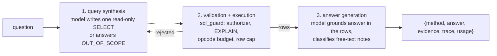

# TAG — Table-Augmented Generation showcase

TAG answers questions over **structured data** by letting the model write a
SQL query, executing that query under a strict guard, and then having the
model reason over the returned rows. Where RAG retrieves document chunks,
TAG retrieves *rows*: the evidence is a validated SQL statement and its
result set, which the answer must quote verbatim.

The demo database is a synthetic serving-analytics snapshot of this very
project: one month of daily per-tier (GPU/CPU) serving metrics plus
free-text incident notes. The flagship question mixes both:

> On the three most expensive GPU days, summarize whether the incident
> notes point mainly to capacity problems or configuration problems.

Answering it needs exact aggregation (top-3 days by cost) **and** semantic
classification of free text (what *kind* of problem each note describes) —
the combination that makes TAG more than text-to-SQL.

## Request path



The guard, not the prompt, is the security boundary. Retried failures are
fed back to the model (at most `max_sql_attempts` total, default 2), then
the pipeline **fails closed**: `answer` is `null`, `error` is set, and no
numbers are fabricated.

## SQL guard

`sql_guard.py` enforces read-only access at the SQLite engine level:

1. **First keyword** must be `SELECT` or `WITH` after stripping leading
   comments (line and block comments, string-literal aware).
2. **Connection authorizer** (`set_authorizer`) vets every access at
   prepare time: only `SQLITE_SELECT`/`SQLITE_RECURSIVE`, only
   `SQLITE_READ` against the allowlisted tables/columns (this also blocks
   `sqlite_master`), only an allowlist of scalar/aggregate functions;
   everything else — insert/update/delete/create/drop/alter/pragma/attach/
   transaction — is denied.
3. **Validation without execution**: `EXPLAIN <sql>` fires the authorizer
   at prepare time.
4. **Bounded execution**: a progress handler aborts the query after an
   opcode budget (default 200 000) → `QueryTimeout`; results are capped
   (default 200 rows) and overflow raises `RowCapExceeded` instead of
   silently truncating; `SQLITE_LIMIT_SQL_LENGTH` is capped at 10 000.

Multiple statements are rejected by `sqlite3` itself ("You can only execute
one statement at a time") and mapped to `SqlRejected`, including
comment-smuggled second statements.

## Data dictionary (synthetic)

Every value in `data/seed.sql` is **invented demo data**. It is not real
GCP billing, not real telemetry, and not measured on the project cluster.
Costs follow `gpu_minutes × ~$0.048` (plausible for an on-demand L4 at
~$2.90/h) purely for realism.

`daily_serving_metrics` — one row per day per tier, 2026-09-01..2026-09-30:

| column | type | meaning |
| --- | --- | --- |
| day | TEXT | ISO date |
| tier | TEXT | `gpu` or `cpu` |
| model | TEXT | serving model name for that tier |
| requests | INTEGER | completed requests that day |
| prompt_tokens | INTEGER | input tokens served |
| completion_tokens | INTEGER | output tokens served |
| gpu_minutes | INTEGER | GPU runtime billed (0 on the CPU tier) |
| est_cost_usd | REAL | estimated daily cost in USD |

`incident_notes` — 12 free-text notes on assorted days:

| column | type | meaning |
| --- | --- | --- |
| day | TEXT | ISO date |
| tier | TEXT | tier the note refers to |
| note | TEXT | free-text incident/observation note |
| category | TEXT | ground-truth label for evaluation ONLY |

`category` exists so the eval can check the model's semantic classification
against a label. It is annotated as an internal label in the synthesis
prompt, and the flagship question can be answered without it: the three
most expensive GPU days are 2026-09-08 ($28.40, KEDA `scaledownPeriod`
misconfiguration → cold starts and a retry storm), 2026-09-17 ($25.10, GPU
OOM and queue backlog), and 2026-09-24 ($22.75, L4 quota exhausted, pods
pending) — two capacity, one configuration → **mainly capacity**.

## Flagship walkthrough

`POST /chat` with the flagship question returns (abridged real response
from the fake-model harness):

```json
{
  "method": "table-augmented-generation",
  "answer": "The most expensive days in scope were 2026-09-08 ($28.40), 2026-09-17 ($25.10), 2026-09-24 ($22.75). Classifying each incident note by its meaning: ... 2 of 3 point to capacity, the rest to 1 configuration - so the notes point mainly to capacity problems.",
  "evidence": {
    "sql": "SELECT m.day, m.est_cost_usd, n.note FROM daily_serving_metrics m JOIN incident_notes n ON n.day = m.day AND n.tier = m.tier WHERE m.tier = 'gpu' AND m.day IN (SELECT day FROM daily_serving_metrics WHERE tier = 'gpu' ORDER BY est_cost_usd DESC LIMIT 3) ORDER BY m.est_cost_usd DESC",
    "columns": ["day", "est_cost_usd", "note"],
    "row_count": 3
  },
  "trace": {
    "stages": [
      {"name": "query_synthesis", "duration_s": 0.00038},
      {"name": "sql_execution", "duration_s": 0.000308},
      {"name": "answer_generation", "duration_s": 0.000082}
    ],
    "sql_attempts": [{"attempt": 1, "sql": "...same SELECT...", "outcome": "ok"}],
    "model": "Qwen/Qwen2.5-Coder-14B-Instruct-AWQ",
    "db_path": ".../showcases/tag/data/serving.db"
  },
  "usage": {"prompt_tokens": 692, "completion_tokens": 211, "total_tokens": 903}
}
```

Stage durations in the fake harness are microseconds; against the real
gateway, `query_synthesis` and `answer_generation` are the LLM calls and
dominate, while `sql_execution` stays sub-millisecond on this tiny dataset.

## Quickstart (local, no GPU, no network)

```bash
python3 -m venv .venv-showcases
.venv-showcases/bin/pip install -r showcases/tag/requirements.txt -r showcases/requirements-dev.txt

TAG_FAKE_MODEL=1 .venv-showcases/bin/uvicorn app:app --port 8091 --app-dir showcases/tag &

curl -s http://localhost:8091/healthz
curl -s -X POST http://localhost:8091/chat \
  -H 'Content-Type: application/json' \
  -d '{"question": "On the three most expensive GPU days, summarize whether the incident notes point mainly to capacity problems or configuration problems."}'
```

`TAG_FAKE_MODEL=1` swaps the gateway transport for a scripted deterministic
model (`fake_model.py`) so the full request path — synthesis, guard,
execution, grounded answer, metrics — runs offline. The SQLite database is
built from `data/schema.sql` + `data/seed.sql` on first startup
(`ensure_database`, idempotent).

**Live mode** needs the real gateway: port-forward Envoy
(`kubectl port-forward -n envoy-gateway-system svc/$ENVOY_SERVICE 8081:80`),
then run uvicorn without `TAG_FAKE_MODEL` and with
`GATEWAY_URL=http://localhost:8081/v1`,
`GATEWAY_API_KEY=<vllm-api-key secret>`, and
`GATEWAY_MODEL=Qwen/Qwen2.5-Coder-14B-Instruct-AWQ`. See
`eval/reports/2026-10-27-tag-live.md` for the exact commands.

Configuration env vars: `GATEWAY_URL` (default `http://localhost:8081`),
`GATEWAY_API_KEY`, `GATEWAY_MODEL`, `TAG_DB_PATH`, `TAG_ROW_CAP` (default
200), `TAG_FAKE_MODEL`.

Endpoints: `POST /chat {question}`, `GET /healthz` (opens the DB
read-only), `GET /metrics` (Prometheus; `ag_demo_tag_stage.duration`,
`ag_demo_tag_result.rows`, `ag_demo_tag_requests`, plus GenAI conventions
`gen_ai.client.operation.duration` and `gen_ai.client.token.usage`).

## Testing

```bash
.venv-showcases/bin/python -m pytest showcases/tag/tests -q
```

Pure local: temporary SQLite databases, fake transport, no network. Covers
seed determinism and aggregates, the guard (statement types, comment
smuggling, unknown tables/columns, functions, row cap, timeout, connection
reuse), the pipeline (flagship E2E, retry recovery, fail-closed,
out-of-scope), and the HTTP contract via httpx TestClient.

## Evaluation

```bash
.venv-showcases/bin/python eval/run_tag_eval.py \
  [--url http://localhost:8091] \
  [--questions eval/showcases/tag_questions.yaml] \
  [--report eval/reports/<date>.md] [--note "context"]
```

Question types: `exact` (expected substrings; any failure exits non-zero
because the data is deterministic), `semantic` (rubric mentions, reported
per item), `invalid` (write temptations; must be rejected/refused),
`out_of_scope` (must not execute SQL). No pass threshold is set yet — the
first runs establish the baseline. The 2026-10-27 fake-model run
(`eval/reports/2026-10-27-tag-local-fake.md`) passed 17/17 and is a harness
baseline, not a model-quality measurement; the live report is `NOT RUN`
until a real gateway session.

## Limitations

- This is a minimal three-stage TAG pipeline with semantic reasoning over
  rows. It is **not** a reproduction of the TAG paper's LOTUS-style
  operator pipelines or of TAG-Bench results, and makes no benchmark
  claims.
- Single-node SQLite; the dataset is 72 rows. The guard's opcode budget and
  row cap matter on larger data, not here.
- SQL synthesis is one model call with error-feedback retries, pinned to
  the GPU coder model by default; there is no schema-linking, few-shot
  library, or query planner in the loop.
- SQL is model-generated, but execution is engine-enforced read-only; the
  model cannot write, attach, or exfiltrate outside the two allowlisted
  tables even if prompted to.
- `incident_notes.category` is evaluation ground truth; a real deployment
  would not ship the label column at all.
- The fake model is a scripted pattern-matcher for demos/tests. It proves
  the pipeline mechanics, not LLM quality.

## Cleanup

```bash
kill %1                                  # stop uvicorn (or: pkill -f "uvicorn app:app")
rm -f showcases/tag/data/serving.db      # derived artifact, rebuilt on next start
rm -rf .venv-showcases                   # local venv
```

Nothing outside the working directory is touched: no cluster resources, no
Terraform state, no network calls in fake mode.
